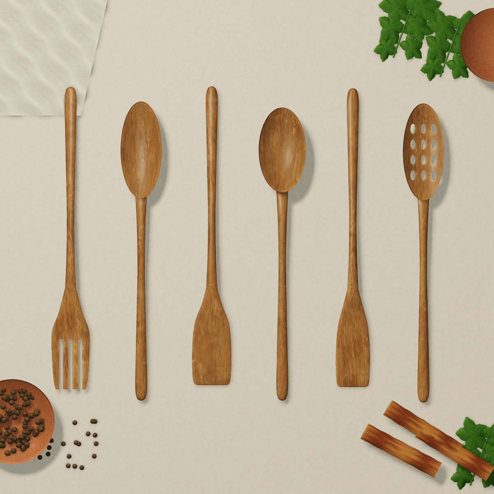
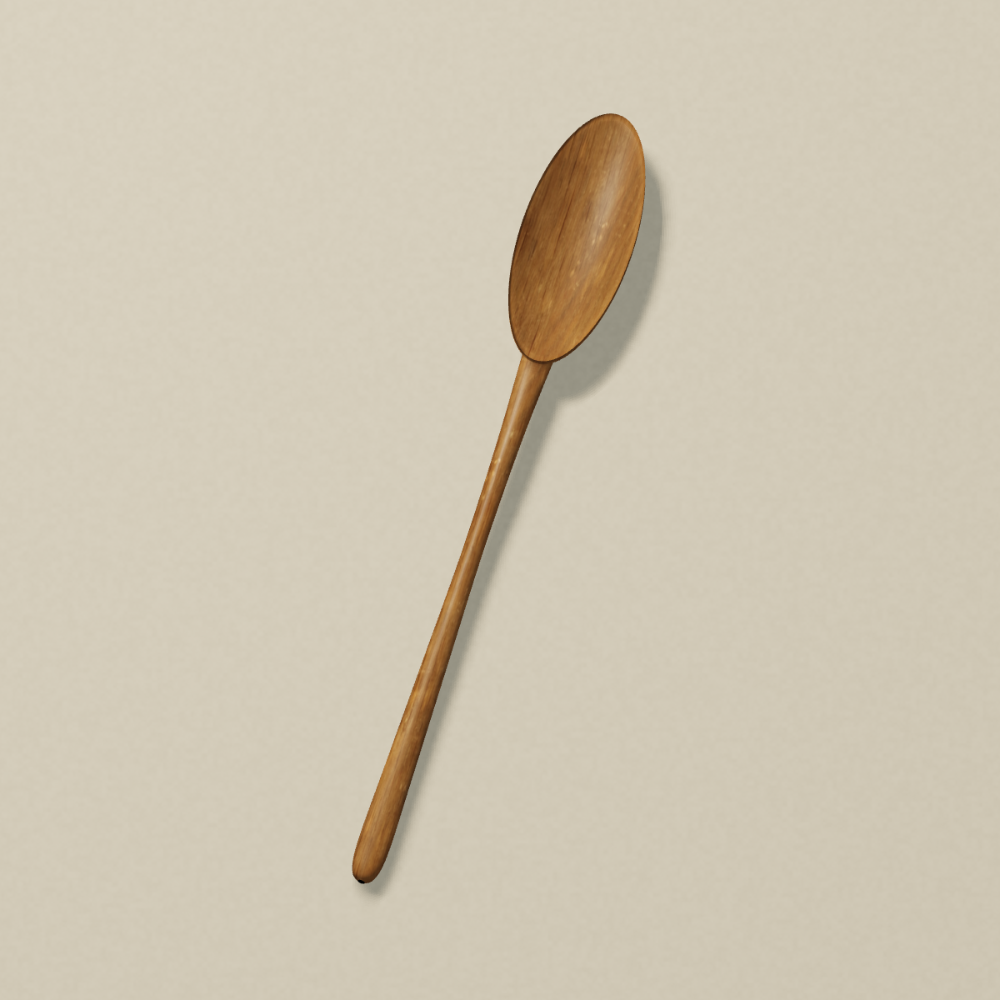

# Wooden Utensils - OpenGL scene

A reference-inspired 3D tabletop study with six wooden utensils, cloth, bowls, peppercorns, cinnamon and herbs. This is **Python + ModernGL**, using real desktop OpenGL 3.3+ and GLSL shaders. It is not C++, a Blender render, a ray tracer, or a photo displayed on a quad.



## Run locally

Install **Python 3.10+** and a working graphics driver with OpenGL 3.3 support. Then:

```sh
git clone https://github.com/Utkarsh-sharma47/wooden-utensils-opengl.git
cd wooden-utensils-opengl
python -m venv .venv
```

Activate the environment:

- Windows PowerShell: `.venv\Scripts\Activate.ps1`
- Windows Command Prompt: `.venv\Scripts\activate.bat`
- macOS/Linux: `source .venv/bin/activate`

```sh
python -m pip install -r requirements.txt
python scene.py
```

Use `python3` instead of `python` if that is your Python command. This private repository requires GitHub access when cloning.

### Window controls

| Key | Action |
| --- | --- |
| S | Toggle hard shadows / filtered shadows |
| T | Toggle overhead / oblique camera |
| P | Save the current frame as `screenshot.png` |
| Esc | Close the window |

The window is fixed-size. Start at a smaller resolution on a slower machine:

```sh
python scene.py --width 720 --height 720
python scene.py --tilt 4 --shadow hard
```

## Single-spoon close-up

A separate view keeps only one wooden spoon and the tabletop, with a closer camera. It does not remove the full scene:

```sh
python scene.py --scene single --tilt 3
python scene.py --scene single --tilt 3 --render single-spoon.png
```



## Render to PNG

On Linux with EGL available, no desktop window is needed:

```sh
python scene.py --render my-render.png --stats my-render.json
python scene.py --render angled.png --tilt 4 --width 1200 --height 1000
python scene.py --render hard.png --shadow hard
```

EGL headless rendering is **not promised on Windows or macOS**. Use the interactive window and P there, or try `--backend default` with a suitable standalone-context setup. `python scene.py --help` lists all options.

## What is implemented

- Generated lofted handles, dished spoon bowls, spatula heads, fork and perforated spoon.
- Six different utensils with alternating handle direction.
- CC0 wood colour, roughness and OpenGL normal maps, with per-object variation.
- GGX direct-light shading, Fresnel/geometry terms and analytic hemisphere ambient fill.
- A 2048-pixel shadow map, optional 7-by-7 PCF filtering, gamma correction and filmic tone mapping.
- Up to 4x multisample anti-aliasing (limited by the driver).
- Oblique view and hard/filtered shadow comparison.

## Scope and limits

This is a working **starting reconstruction**, not a photorealistic or exact match to the supplied photo. Props, utensil silhouettes, cloth folds and material detail are simplified. Spoon heads and handles are overlapping separate meshes rather than a single production topology. Fork slots and spoon holes use fragment cutouts in both visible and shadow passes; spoon holes also have generated inner walls. There is no guarantee of watertight exportable topology.

Lighting uses one point light and an analytic ambient fill. **No HDRI, image-based lighting, ray tracing or physically simulated cloth** is implemented. PCF softens shadow-map edges but does not simulate area-light visibility. The reference photograph is not redistributed.

Course language, library and asset rules have not been confirmed. If the course requires C++/GLUT, hand-written raw OpenGL bindings, or no external textures, this implementation needs adaptation before submission. Do not present it as a C++ solution.

## Tests and verification

```sh
python -m unittest -v
python tests/render_smoke.py
```

The first command checks generated geometry and local assets without opening OpenGL. The second creates an EGL OpenGL context, renders both shadow modes and the single-spoon view, checks for a nonempty image and image differences, and saves results under `test-output/`.

Verified on Linux using Mesa llvmpipe software OpenGL 4.5: EGL renders and a three-frame GLFW window under Xvfb. Actual previews are `preview.png`, `oblique.png`, `single-spoon.png` and `hard-shadows.png`; renderer details are in `render-info.json`. The recorded first-frame time is **not sustained FPS** or a user-GPU benchmark. Windows, macOS and the user's laptop have not been tested.

If GLFW cannot open a display, run on a normal desktop session or use EGL on headless Linux. On Debian/Ubuntu, missing native libraries may require `sudo apt install libglfw3 libegl1 libgl1-mesa-dri`. A graphics-driver error is not fixed by reinstalling Python packages alone. macOS may require a separate GLFW installation such as `brew install glfw`.

## Files

- `scene.py`: geometry, materials, GLSL, shadow passes, camera and app entry point.
- `wood-*.jpg`: bundled CC0 material maps, so no asset download is needed to run.
- `tests/`: geometry tests and EGL rendering smoke test.
- `CREDITS.md`: asset provenance and reading references.

No open-source license has been selected for the original project code. Third-party assets retain their own terms in `CREDITS.md`.
